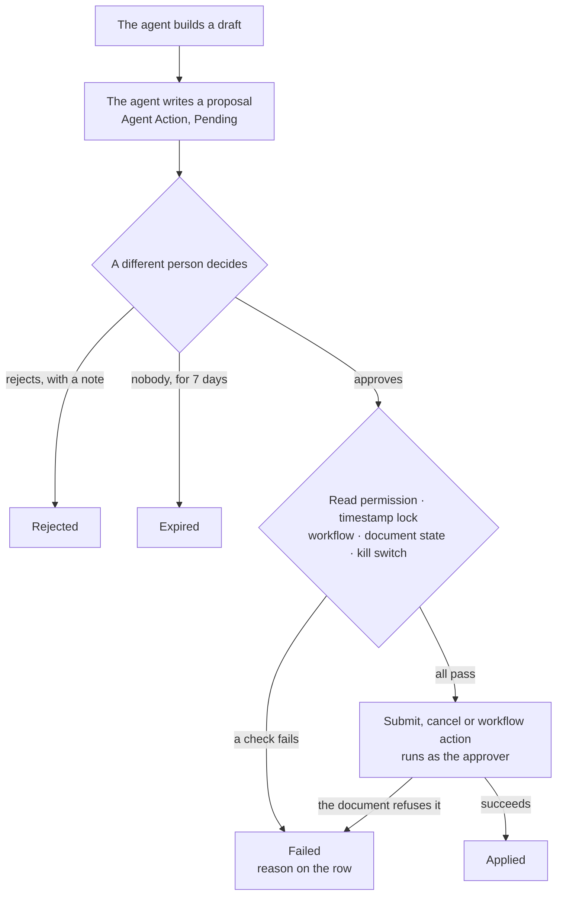

# Approvals

An agent can build a document. It cannot commit one. When an agent decides
something should be submitted or cancelled, or that a workflow should move on,
it writes a proposal and stops, and a person decides.

## What a proposal is

A proposal is an **Agent Action** row: a request, not an act. It names the
document, what it wants — a submit, a cancel, or a workflow action — and the
agent's reason. It also
stores the document's timestamp at the moment it was proposed — that snapshot
does more work than it looks like, below.

Nothing else can create one. The doctype grants create and write to no role at
all: a proposal arrives through the proposal tool and leaves through an
approval, a rejection, or expiry. There is no path where a row appears or
changes some other way.

Find them under **Agents → Review → Pending Actions**.

## Who may decide

You need the **Agent Approver** role, and you must not be any of these three
people:

- whoever asked for the proposal;
- whoever the run was acting as;
- whoever owns the agent.

An approval that none of those three could avoid making is not a review. If you
are blocked, the screen says which of the three you are.

## Who is told

A proposal nobody hears about waits until it expires. So the app tells people,
with frappe's own notifications: the bell at the top of the desk. These are
Alert notifications, and frappe does not send email for those — the bell is the
only place they appear.

**When a proposal is written,** the approvers who could decide it are told. That
is every enabled user with the Agent Approver role who also:

- is none of the three people above, who may not decide it;
- may read the document;
- may submit it (or cancel it, for a cancel proposal).

For a workflow action, the last line is different. The approver must hold a role
the step is open to. They also need the right the step needs: submit when the
step submits the document, cancel when it cancels it, write otherwise. If the
document has already left the state the agent proposed from, nobody is told:
the approval would fail. The step's condition and self-approval are still the
Workflow's call, when the approver applies it.

An approver who fails any of these is not told. They could not approve it, and
an approver who may not submit the document would only turn the proposal into a
**Failed** one. At most 20 approvers are told, in alphabetical order; everyone
with the role still finds it under **Pending Actions**.

**When a proposal ends,** the person who asked is told: it was applied, rejected,
failed, or expired. So is the user the run was acting as, if that is someone
else. A rejection carries the start of the approver's note; the full note is on
the proposal.

A notification names the agent, the verb and the document, and the approver's
note on a rejection — nothing else. For a workflow action, the verb is the
workflow's own action and the state it starts from. It does not quote the agent's reason or any
field of the document. Open the
proposal to read those, behind the usual permission checks.

To stop these notifications for yourself:

1. Click the bell at the top of the desk.
2. Click the settings icon.
3. Clear **Enable System Notification**.
4. Click **Save**.

This switch stops all your desk notifications, not only the ones about proposals.
There is no separate switch for agent proposals.

## What you are agreeing to

Open the document and read it. The proposal is a request to act on *that record
as it now stands*, and approving is you saying you read it.

The app enforces that literally. Approving sends back the timestamp of the
version you looked at, and a document that changed underneath you refuses the
approval and asks you to read it again. This is a real check, not a courtesy:
frappe's own stale-document guard cannot fire on this path, so this timestamp is
the only thing standing between you and approving a version you never saw.

You also cannot approve a document you may not read. Read permission is proved
before anything is written — an approval of a record you cannot open is a
signature on a blank page.

## Approving

Approving applies the change **as you**. The submit or cancel runs in your own
session under your own permissions, with nothing bypassed. If you may not submit
that document by hand, approving does not submit it either.

That has a consequence worth expecting: **a failed apply is normal, not a bug.**
Submitting re-runs the document's full validation, so a draft that was valid
when the agent built it can legitimately fail now — a closed period, a credit
limit, a mandatory field somebody cleared. The proposal is recorded as **Failed**
with the reason on the row, and nothing is half-applied.

A few things are refused outright:

- **A submit or cancel on a document governed by an active Workflow.** Frappe
  does not stop a server-side submit on a workflow doctype — it would teleport
  the document past every approval step in the workflow. So submit and cancel
  proposals refuse those doctypes, and the refusal is checked again immediately
  before applying, in case the workflow was switched on in between. The agent
  proposes a workflow action instead, below.
- **A document no longer in the right state** — a submit proposal for something
  already submitted, a cancel for something that is not.
- **A document that no longer exists.**
- **Anything, while the kill switch is off.** A site that has stopped trusting
  the runtime should not be applying its output by hand either.

## Workflow actions

Leave Applications, Expense Claims, Purchase Orders and many custom doctypes
move through a **Workflow**: Draft, then Pending Approval, then Approved. On
those documents the agent proposes one of the workflow's own actions, such as
**Approve** or **Send for Review**, with the `propose_transition` tool.

The agent can only propose an action the workflow offers *the user it runs as*:
a transition out of the document's current state, open to one of that user's
roles, with its condition met. If the agent names another action, it is refused
and told which ones are open. Self-approval and document permissions are not
checked at this point. They are checked for the approver, below.

The proposal records the action **and the state it was proposed from**. Workflows
often reuse an action name: Draft → *Approve* → Manager Approved → *Approve* →
Approved. A proposal to approve out of Draft never becomes the second Approve.

The approver applies the action. Frappe's own workflow engine runs it in the
approver's session, so the workflow checks the approver, not the agent:

- the transition must be open to one of **the approver's roles**;
- the transition's **condition** must still hold;
- if the transition does not allow self-approval, the approver must not be the
  document's owner;
- the approver needs the document permission the next state needs — submit, if
  the action submits it.

Every check above this section still runs first: separation of duties, read
permission, the timestamp lock and the kill switch. Then two more:

- **The document must still be in the state the agent proposed from, under the
  same Workflow.** If someone moved it on, the approval fails. The agent can
  propose again from the new state.
- **The doctype must not submit in the background.** Frappe would queue the
  submit, and the approval could not tell whether it went through. Apply the
  action from the document itself.

The agent never applies a workflow action itself. No tool can.

## Rejecting

Rejecting requires a note. That is deliberate — the note is the answer to the
proposal, and the agent's reason deserves one back.

Rejection works even when the kill switch is off. Emptying the queue is exactly
what a stopped site should still be able to do.

## Expiry

A proposal nobody decides expires after seven days, changeable at **Agent
Settings → Action Expiry Days**. A daily job sweeps them; a proposal past its
window is refused even if the sweep has not run yet.

Expiry is not a decision. Nobody is recorded as deciding it, and the agent is
free to propose the same thing again.

## The states

| Status | Means |
|---|---|
| **Pending** | Waiting for a person |
| **Applied** | Approved, and the submit, cancel or workflow action went through |
| **Failed** | Approved, but the document refused it — reason on the row |
| **Rejected** | A person said no, with a note |
| **Expired** | Nobody decided in time |

## Did anyone actually read it?

Every applied proposal records **Edited Before Approval**: whether the document
changed between the agent proposing it and the approval going through. It is
computed just before the apply, because submitting overwrites the timestamp it
is measured against.

**Agents → Review → Review Quality** reports on it. Read it the right way round.
A high edit rate is not a problem — it means reviewers are reading drafts and
correcting them, which is the system working. A rate at or near zero across many
approvals and many approvers is the signal worth investigating: it can mean the
agent is excellent, and it can mean nobody is looking.

It measures applied proposals only. A rejection applied nothing, so it is left
out rather than counted as an unedited approval.
