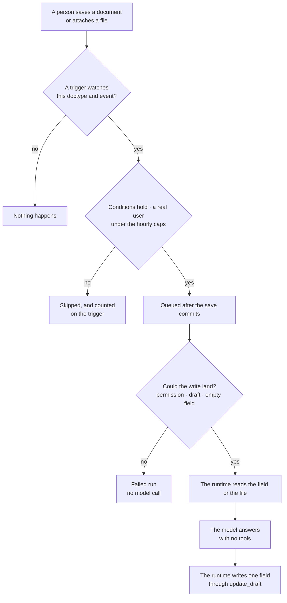

# Agent triggers

A trigger runs an agent when something happens to a document, and writes the
result into one field of that document. Nobody opens a chat.

Two examples:

- A supplier attaches a scanned invoice to a Purchase Order. The trigger copies
  the scan's text into **Invoice Text**.
- Somebody fills in a ticket's **Description**. The trigger asks the agent for a
  one-line summary and writes it into **Summary**.

## Who a trigger runs as

**The person whose action fired it.** The one who saved the document, or who
attached the file. The run is bound to them exactly as a chat run is bound to the
person chatting, and it can do no more than they could do by hand, narrowed by
the agent's access rules.

Two consequences follow, and both are deliberate:

- **Administrator and Guest never fire a trigger.** A save made by the scheduler,
  by an incoming email, by a Guest web form or by Administrator has no real person
  behind it. The event is skipped and counted on the trigger. An integration that
  signs in as its own user does fire triggers, as that user.
- **The same trigger can succeed for one person and fail for another.** A person
  who may read a document but not change it can attach a file to it. Their run
  fails before the model is called, with a reason, and costs nothing.

The trigger's agent must run as **Session User**. An agent that runs as a service
user is refused when you save the trigger. A service user started by somebody
else's document is a deputy that document could steer: it would read with the
service user's rights and write where the person who attached the file can read
it. That mode needs its own design and is not in this release.

The agent's **Allowed Roles** still apply. The **Agent User** role is not
required: it controls who may chat, not whose saves may fill in a field.

## What the agent can do on a triggered run

Less than in chat, on purpose.

- **The model holds no tools.** The runtime reads the input and hands it to the
  model. If the model asks for a tool anyway, the call is refused and written to
  the audit trail.
- **The input is one thing.** For a field event, the value of the source field.
  For an attachment, the text of that file, read through `read_document`, with a
  scan read by the model profile when it supports PDFs or images.
- **Everything from the document is untrusted.** The input reaches the model
  inside `<untrusted>` tags. The only instructions are the agent's own and the
  trigger's.
- **The runtime writes one field.** The model's answer goes into the target
  field through `update_draft`, the same permission-checked path a chat agent
  uses, with its own audit row. The model cannot choose another field or another
  document.
- **Drafts only.** A submitted or cancelled document is refused. Nothing is ever
  submitted, cancelled or deleted.
- **One line on the timeline.** After the write, the document gets a note naming
  the agent, the trigger and the run. The version history shows the person the
  run acted for; the note says an agent wrote the value.

So the most a hostile document can do is change the text that lands in that one
field.

**File Text** triggers skip the model completely when the PDF has a text layer.
The text is copied as read. A scan or an image is read by the model profile,
which costs tokens, and the run records them.

## What fires a trigger

| Event | Fires when |
|---|---|
| **Attachment Added** | A file is attached to a document of the doctype. A file uploaded before the document was first saved fires when the document is created. **File Extensions** narrows it. |
| **Field Changed** | The source field changes. On a new document, when it is created with the field filled. |
| **Document Inserted** | A document of the doctype is created. |

**Conditions** narrow any event. Each row is a field, an operator and a value,
and every row must hold. For an attachment, the conditions are checked on the
document the file hangs off.

These never fire a trigger:

- a save made inside an agent tool call, including the trigger's own write. One
  trigger never starts another;
- installing, migrating and patching;
- a data import, while **Suppress On Import** in Agent Settings is on.

## The limits

| Limit | Default | When it is reached |
|---|---|---|
| **Max Runs Per Hour** | 30 | Events past it are skipped and counted |
| **Max Runs Per User Per Hour** | 10 | Same, per person. An event past a person's own cap does not count against the trigger's cap |
| **Daily Token Budget** on the trigger | empty | The trigger stops for the day |
| **Daily Token Budget** on the agent | Agent Settings | The trigger stops for the day |
| **Global Enabled** in Agent Settings | on | No trigger fires, and a queued run is cancelled |

**One run per document per trigger.** An event that arrives while a run is
working on the same document waits. When that run ends, one more run starts and
reads the newest state. A burst of ten edits costs two runs, not ten. Files are
the exception: each waiting file gets its own run, one after the other.

**An answer made from text that has since changed is not written.** If the
source field changes while the model works, the answer is dropped and the run
that change queued writes instead.

**A skipped event is not retried.** A bulk edit past the hourly cap leaves the
rest empty. Use **Run on a Document** to fill them in.

Give a trigger its own budget when its agent also serves chat. Otherwise a busy
day of uploads can spend the agent's whole budget.

## Set up a trigger

Before you start, the agent needs these:

- **Run As** is Session User.
- **Autonomy** is Draft.
- An access rule on the doctype allows **Update Draft**. For a field event, it
  also allows **Read**.
- For an attachment event, **May Read Files** is on.

Then:

1. Open **Agents → Build → Triggers**.
2. Click **New**.
3. Type a **Trigger Name**.
4. Select the **Agent**.
5. Select the **Document Type**.
6. Select the **Event**.
7. For **Field Changed** or **Document Inserted**, type the **Source Field**. Use
   the fieldname, not the label.
8. For **Attachment Added**, type the **File Extensions** to read, for example
   `pdf, png, jpg`. Leave it empty to read any file the agent can read.
9. Add **Conditions** if the trigger applies to some documents only.
10. Select what the trigger **Writes**.
    - **Agent Answer**: the model works on the input.
    - **File Text**: the file's text is copied as read.
11. For **Agent Answer**, write the **Instruction**. Say what to produce and how
    long it may be.
12. Type the **Target Field**. It must be Small Text, Text, Long Text, Text
    Editor, Markdown Editor or Select.
13. Keep **Only If Empty** on, unless the trigger may overwrite a value a person
    wrote.
14. Set the limits.
15. Click **Enabled**.
16. Save.

Saving refuses a trigger that cannot work, and says why. It refuses a target
that is read-only, sensitive, the workflow state or the source field, and a
source that is a password or a table.

Test it on one document:

1. Click **Run on a Document**.
2. Select a draft.
3. Click **Run**.
4. Open **Agents → Activity → Runs**. Find the run with surface **Trigger**.

The run is yours: you must be able to change that document.

## Reading what happened

- **Agent Run** — surface **Trigger**, the trigger, the document, and for an
  attachment the File. The input message is exactly what the model was given.
- **Agent Tool Call** — the `read_document` and `update_draft` calls the runtime
  made, and any tool the model asked for and was refused.
- **The document's timeline** — the note after each write.
- **The trigger form** — today's skipped events, by reason.

A failed run says why in its **Error**. The usual reasons are that the person may
not change the document, the target already has a value, the document is
submitted, or a Select answer was not one of the options.

## Things to know

- **Select targets are checked, not guessed.** The answer must be one of the
  options exactly, or nothing is written.
- **A target field is model output.** Do not let it drive an Assignment Rule, a
  Notification or a Workflow without a person in between, unless it is a Select
  field whose options you trust.
- **Only If Empty and Field Changed together write once.** A later change to the
  source field finds the target filled and stops. Turn Only If Empty off to keep a
  summary current; a person's edit to the target is then overwritten.
- **A person still editing the form can lose their next save.** The write lands a
  few seconds after their save and changes the document under them. Their next
  save then fails with "has been modified after you have opened it", and they
  must reload. Pick events people make at the end of their work, such as an
  attachment, not a field they are still typing in.
- **A trigger that has run cannot be deleted.** Its runs link to it, and runs are
  never deleted. Clear **Enabled** instead.
- **Child tables and single doctypes** cannot have triggers.
